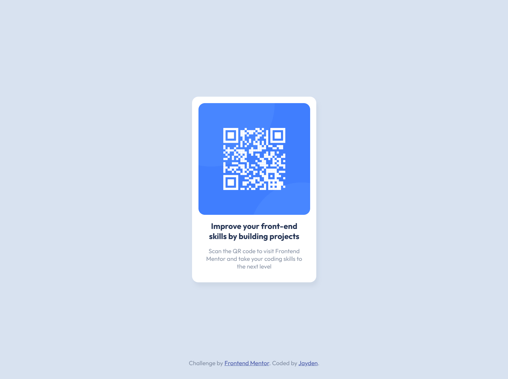

# Frontend Mentor - QR code component solution

This is my solution to the [QR code component challenge on Frontend Mentor](https://www.frontendmentor.io/challenges/qr-code-component-iux_sIO_H).

## Overview

### Screenshot

### Links

- Repository: [frontend-mentor-solutions](https://github.com/JaydenZhou01/frontend-mentor-solutions)
- Live site: [View the QR code component](https://jaydenzhou01.github.io/frontend-mentor-solutions/qr-code-component/)

## Built with

- Semantic HTML5 markup
- CSS custom properties
- Flexbox
- Responsive design
- Google Fonts

## What I learned

This project helped me practise building a simple, responsive component from a design reference. I also learned how to:

- Structure a page with semantic HTML
- Use Flexbox to center content vertically and horizontally
- Match colors, spacing, typography, and border radii from a style guide
- Deploy a static site with GitHub Pages and GitHub Actions

## Continued development

I plan to continue improving my responsive layout skills and build more Frontend Mentor challenges using reusable CSS patterns and accessible HTML.

## Useful resources

- [Frontend Mentor challenge](https://www.frontendmentor.io/challenges/qr-code-component-iux_sIO_H) - The original challenge and design requirements
- [MDN CSS Flexbox](https://developer.mozilla.org/en-US/docs/Learn_web_development/Core/CSS_layout/Flexbox) - Helpful Flexbox documentation
- [GitHub Pages documentation](https://docs.github.com/en/pages) - Documentation for hosting the site

## AI collaboration

GitHub Copilot was used to help configure the GitHub Pages deployment workflow, verify the deployment, and update project documentation.

## Author

- GitHub: [@JaydenZhou01](https://github.com/JaydenZhou01)
- Frontend Mentor: [@JaydenZhou01](https://www.frontendmentor.io/profile/JaydenZhou01)

## Acknowledgments

Thanks to Frontend Mentor for providing the challenge and design assets.
